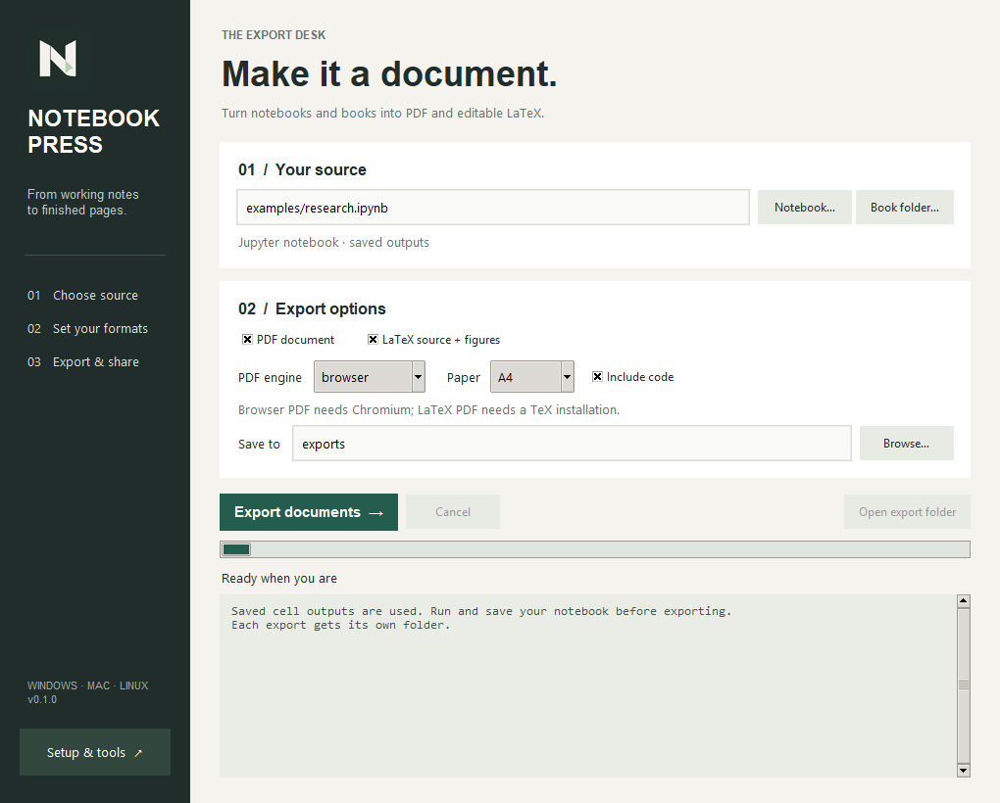

<p align="center">
  
</p>

<h1 align="center">Notebook Press</h1>
<p align="center">From working notebooks to finished documents.</p>
<p align="center">
  <a href="https://github.com/dc73/notebook-press/releases/latest">Download</a> &middot;
  <a href="docs/usage.md">Setup guide</a> &middot;
  <a href="https://github.com/dc73/notebook-press/issues">Report an issue</a>
</p>

A desktop app for **Windows, macOS, and Linux** that exports Jupyter notebooks and Jupyter Books to **PDF** and **editable LaTeX**, with equations, saved results, and supporting figures.



A quiet sage workspace with rounded controls, a notebook summary, and a single PDF / LaTeX format selector. Export details stay tucked away until you need them; the export action stays visible as you scroll.

## Download

| Platform | Download | Open |
| --- | --- | --- |
| Windows (x64) | [NotebookPress.exe](https://github.com/dc73/notebook-press/releases/latest/download/NotebookPress.exe) | Double-click the single executable. |
| macOS (Apple Silicon) | [macOS app](https://github.com/dc73/notebook-press/releases/latest/download/NotebookPress-macOS.zip) | Extract and open `Notebook Press.app`. |
| Linux (x64) | [Linux app](https://github.com/dc73/notebook-press/releases/latest/download/NotebookPress-Linux.tar.gz) | Extract and run `NotebookPress/NotebookPress`. |

Windows needs no installer or Python setup. Release builds include the browser used for notebook PDFs and render math offline. The first Windows launch extracts the app and may take a moment. Builds are unsigned; macOS and Linux downloads appear after their native release builds finish.

## Three steps

1. **Choose your source:** an `.ipynb` file or a Jupyter Book project folder.
2. **Choose your formats:** PDF, LaTeX, or both. Set notebook code visibility and paper size.
3. **Export:** watch progress, then open the completed export folder.

Each export gets a new folder. The app uses saved notebook outputs and does not rerun cells. Original sources and existing exports are preserved.

## What it supports

- Notebook PDF through Chromium or XeLaTeX.
- Portable LaTeX projects with output figures, attachments, and linked images.
- Jupyter Book 1 and Jupyter Book 2 / MyST projects.
- A4 and Letter paper; include or hide notebook code.
- Progress logs, cancellation, tool checks, and remembered settings.
- Desktop app and command-line workflows.

Notebook LaTeX export includes Pandoc. Full book projects need their matching book engine, and LaTeX PDF typesetting needs TeX. See the [tool requirements and book examples](docs/usage.md#supported-inputs-and-required-tools).

## Run from source

Use Python 3.11 or later:

```sh
python -m venv .venv
```

Activate it with `.venv\Scripts\Activate.ps1` in Windows PowerShell, or `source .venv/bin/activate` on macOS / Linux. Then install and launch:

```sh
python -m pip install -e .
python -m notebook_press --install-browser
python -m notebook_press
```

Linux also needs Tk (`python3-tk` on Debian / Ubuntu). The [setup guide](docs/usage.md) covers system packages and optional book engines.

For a terminal export:

```sh
python -m notebook_press export research.ipynb -o exports --format both
```

## Build and test

```sh
python -m pip install -e '.[dev,book-v1,book-v2]'
python -m playwright install chromium
python -m pytest -q
python scripts/build.py --with-browser --onefile  # Windows single executable
python scripts/smoke_packaged.py
```

Use `python scripts/build.py --with-browser` for a macOS app or Linux application folder. [GitHub Actions](https://github.com/dc73/notebook-press/actions) tests native builds, checks packaged PDF and LaTeX exports, and attaches all three downloads to tagged releases.

Maintained by [dc73](https://github.com/dc73). [Logo and branding](docs/branding.md).
